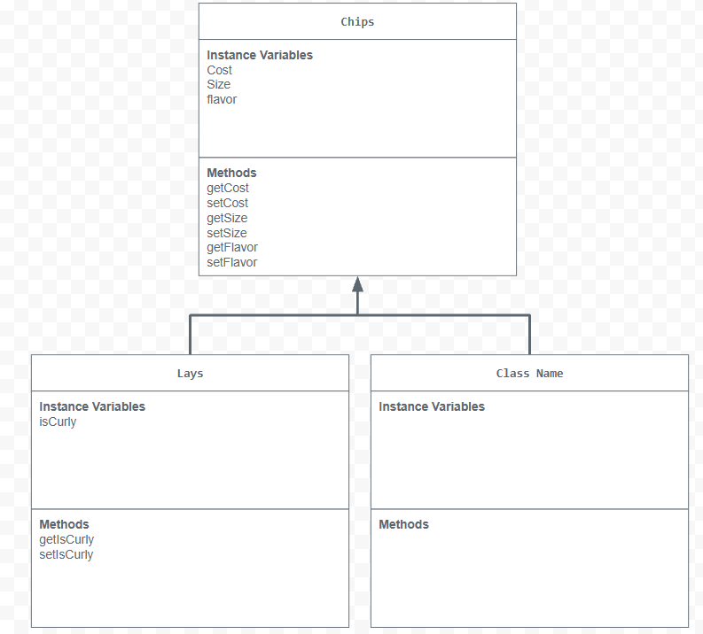

# Store-managment

# Unit 2 - Store Management Project

## Introduction

You are opening a new business in your community! Businesses often need programs to manage the products and services they offer and track orders and requests from customers. Your goal is to create a store management system for your business.

## Requirements

Use your knowledge of object-oriented programming and class structure and design to create your store management system:
- **Create a class hierarchy** – Develop a superclass that represents a product or service your business offers and one or more subclasses that extend the superclass to represent more specific types of products or services.
- **Declare instance variables** – Declare instance variables in the superclass that are shared with the subclasses and instance variables in the subclasses that are not shared with the superclass.
- **Write constructors** – Write no-argument and parameterized constructors in the superclass and subclasses. Subclass constructors use the super keyword to call the superclass constructor.
- **Implement accessor and mutator methods** – Write accessor and mutator methods for instance variables that should be accessible and/or modifiable from outside of the class.
- **Implement a toString() method** – Write toString() methods in the superclass and subclasses that return information about the state of an object.

## UML Diagram

Embed your UML Diagram here. Upload the image of your UML Diagram to your repo, then use Markdown to insert your image here:

## Description

1. Write a description of your project here. Include what your store you made, and why you chose this topic. In your description, include as many vocab words from our class to explain how you represented the item/service from your store. If you have user input, explain how the user will interact with your store such as which questions are prompted to the user, what response is your program expecting, and how that is used to output information for your store in the console.

    My project sells chips, or more specifically lays. I chose to create chips as it was the first thing that came to mind as well as being fairly easy to create subclasses. The program works by getting user input through the scanner than saving that input and using mutator methods to update the instance variable. Although cost is an instance variable, it is not set directly through user input but rather through the user's choices. In my program, it only expects three value types: boolean, double, and string.

2. How is this project related to STEAM (Science, Technology, Engineering, Art, and Mathematics)? Provide explicit examples from the project and details as possible. 

    This project is related to technology as I made this project using a computer which is a big part of technology since a computer falls under devices. I used engineeing as I had to problem solve through my code and fix the bugs.

3. What SLOs did you demonstrate during completing this project?

    Some student learning outcomes I demonstrated are being a critical thinker and being a self-directed goal-oriented individual. I demonstrated critical thinking as the code written is fairly hard for someone just learning java. The code written took time to debug and work out leading me to become a critical thinker. I became a self-directed goal-oriented individual as I was able to set goals such as where to finish on a certain day and complete it.

